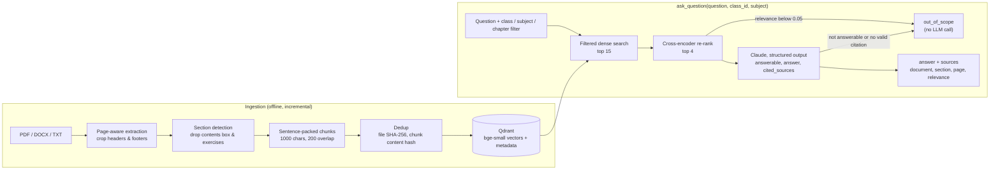

# RAG Question Answering over Study Materials

**APPINESS · Tech Lead & AI Engineer assessment** · an AI tutor for CBSE Class 11 Physics, built on the NCERT textbook

A student asks a question. The system retrieves the relevant textbook passages and Claude answers **only from those passages**, citing chapter, section and page. When the material doesn't cover the question, the system says so instead of guessing.

> **Start here: [`RAG_QA_System.ipynb`](RAG_QA_System.ipynb)**. The implementation, the reasoning behind every design decision, and the executed tests are all in one notebook. Every output in it comes from a real run against the Claude API; nothing is mocked.

---

## Results at a glance

From the executed notebook, run against 5 NCERT chapters (327 chunks):

| Test (§8.4) | Question | Status | Cited sources |
|---|---|---|---|
| Student question | Why does pressure increase with depth in a liquid? | `success` | Fluids §9.2.2 p.4 · Summary p.19 |
| Student question | State Newton's second law of motion. | `success` | Laws of Motion §4.5 p.5–6 · Summary p.18 |
| Student question | What is the work-energy theorem? | `success` | Work, Energy & Power §5.2 p.3 · §5.6 p.6 · Summary p.16 |
| Student question | What are beats, and how is the beat frequency related to the two frequencies? | `success` | Waves §14.7 p.16–17 · Summary p.19 |
| Student question | What is the difference between average and instantaneous velocity? | `success` | Motion in a Straight Line §2.2 p.2–3 · Summary p.9 |
| Information unavailable | What is escape velocity? *(Gravitation not in corpus)* | `out_of_scope` | Stopped at the relevance gate, no LLM call |
| Information unavailable | Who won the FIFA World Cup in 2022? | `out_of_scope` | Stopped at the relevance gate, no LLM call |
| Metadata filtering | What is conserved when two bodies collide? *(chapter = Laws of Motion)* | `success` | Laws of Motion §4.7 p.9–10 · Summary p.19 |
| Metadata filtering | State Newton's second law… *(class_id = 12)* | `out_of_scope` | No Class 12 material, so nothing to retrieve |
| New upload, before | What is the first law of thermodynamics? | `out_of_scope` | Retrieval matched Newton's *first law*; **the LLM rejected it** |
| New upload, after | *(same question, after indexing Ch 11; 327 → 398 chunks, no rebuild)* | `success` | Thermodynamics §11.8.2 p.10 · Summary p.14–15 |

<details>
<summary><b>Example response</b> (the assignment's sample question)</summary>

```json
{
  "question": "Why does pressure increase with depth in a liquid?",
  "answer": "In a liquid, the pressure at a depth h is given by P = Pa + ρgh, where Pa is the atmospheric pressure at the surface, ρ is the density of the liquid (assumed uniform) and g is the acceleration due to gravity. Since ρ and g stay the same, the extra pressure ρgh grows directly with depth h. The excess P − Pa is called the gauge pressure.\n\nOnly the height of the liquid column matters, not the area or shape of the container. That is why vessels of different shapes, joined at the bottom, fill to the same level (the hydrostatic paradox).\n\nExample: 10 m below a lake's surface, P = 1.01 × 10^5 Pa + 1000 × 10 × 10 Pa ≈ 2.01 × 10^5 Pa, about 2 atm. That is double the surface pressure. At 1 km depth the increase is about 100 atm, so submarines must be built to withstand it.",
  "sources": [
    {
      "document": "NCERT_Class11_Physics_Ch09_Mechanical_Properties_of_Fluids.pdf",
      "chapter": "Mechanical Properties of Fluids",
      "section": "9.2.2 Variation of Pressure with Depth",
      "page": 4,
      "relevance_score": 0.91
    },
    {
      "document": "NCERT_Class11_Physics_Ch09_Mechanical_Properties_of_Fluids.pdf",
      "chapter": "Mechanical Properties of Fluids",
      "section": "Summary",
      "page": 19,
      "relevance_score": 0.79
    }
  ],
  "status": "success"
}
```
</details>

---

## Architecture



## Design decisions

| Component | Choice | Why |
|---|---|---|
| Extraction | **PyMuPDF**, python-docx | Fast and page-aware. Coordinate cropping removes running headers and footers without damaging equations |
| Chunking | Section-aware sentence packing, **1000 / 200 chars** | ~220 tokens holds one idea per chunk. Chunks never cross a section and never cut a sentence. Fits the 512-token limit of both models |
| Embeddings | **`BAAI/bge-small-en-v1.5`** via FastEmbed (ONNX) | Strong MTEB retrieval at 33M params. CPU-fast (whole corpus in ~30 s), no PyTorch, no data sent to a third party |
| Vector DB | **Qdrant** (embedded, persisted) | Payload filters run inside the search. Upsert and delete by id allow incremental updates. The same code moves to Qdrant Server or Cloud |
| Re-ranking | **`ms-marco-MiniLM-L-6-v2`** cross-encoder | Better ordering and a relevance score that actually separates in-scope from out-of-scope (below) |
| LLM | **Claude `claude-opus-5-5`**, low effort, `messages.parse` + Pydantic | Faithful to context. Schema-validated `{answerable, answer, cited_sources}` with no free-text parsing. Model is configurable via `CLAUDE_MODEL` |

**Why a re-ranker, in numbers.** Cosine similarity can't tell answerable from unanswerable questions; the cross-encoder can:

| Question | In the corpus? | Best cosine similarity | Best re-ranker relevance |
|---|---|---|---|
| What is the work-energy theorem? | yes | 0.816 | 1.000 |
| Why does pressure increase with depth? | yes | 0.751 | 0.451 |
| What is escape velocity? | no | 0.671 | 0.006 |
| Explain the photoelectric effect. | no | 0.653 | 0.000 |
| Who won the FIFA World Cup in 2022? | no | 0.460 | 0.000 |

The gate sits at **0.05**, well inside that margin. Of four small cross-encoders tested on these probes, MiniLM-L-6 had the widest margin and was the fastest. The one probe that slips through, *first law of thermodynamics* matching Newton's *first law* (0.52), is caught by the second guard: the LLM's `answerable` verdict.

**Hallucination control is layered:** relevance gate → grounded-only system prompt → explicit `answerable` field → citations validated in code → references list only what the model cited → sources treated as data, not instructions.

**Redundancy is handled at every stage:** file hash (duplicate uploads, even renamed) → same name with new content replaces the old edition → content-hash chunk ids (identical passages stored once, idempotent re-ingestion) → references de-duplicated per (document, page).

## Assignment coverage

| Requirement | Notebook section |
|---|---|
| Task A: ingestion, chunking, metadata, empty / duplicate / failed files | §1, §2 (edge-case demo) |
| Task B: embeddings, vector DB, semantic search, top-k, metadata filters, incremental add | §2, §3 |
| Task C: LLM integration, prompt design, citations, no unsupported answers | §4 |
| Task D: `ask_question(question, class_id, subject)` with `OutOfScopeError` | §5 |
| §8.3 explanations 1–9 (architecture … limitations) | §1–§4, §7 |
| §8.4 tests: 5 questions, retrieval results, unavailable info, filtering, new upload | §6.1–§6.4 |

## Run it

Requires Python 3.10+ (tested on 3.12) and an [Anthropic API key](https://console.anthropic.com/).

```bash
git clone https://github.com/rohanmehta98/Appiness.git && cd Appiness
python -m venv .venv
.venv\Scripts\activate              # macOS / Linux: source .venv/bin/activate
pip install -r requirements.txt
copy .env.example .env              # macOS / Linux: cp .env.example .env, then set ANTHROPIC_API_KEY
jupyter lab RAG_QA_System.ipynb     # Run → Run All Cells
```

The first run downloads about 150 MB of embedding and re-ranker models; a full run takes 1–2 minutes and costs a few cents in API calls. To try your own questions, add a cell at the end:

```python
show(ask_question("What is Bernoulli's principle?", class_id=11, subject="Physics"))
show(ask_question("What is friction?", class_id=11, subject="Physics", chapter="Laws of Motion"))
```

## Repository layout

```
RAG_QA_System.ipynb     implementation, design notes and executed tests
data/study_materials/   5 NCERT Class 11 Physics chapters, indexed at start
data/new_uploads/       Ch 11 Thermodynamics, used in the "new upload" test
requirements.txt
.env.example            ANTHROPIC_API_KEY (required), CLAUDE_MODEL (optional)
```

The API key is read from a local `.env` file, which is git-ignored. The vector index (`qdrant_db/`) is rebuilt by the notebook and is not committed.

## Limitations and next steps

Covered in detail in notebook §7. In short: PDF equations and symbols are partly garbled (next step: a math-aware parser), figures and scans are not indexed (next step: OCR and figure captioning), there is no hybrid BM25 + dense search or conversational query rewriting yet, embedded Qdrant is single-process, and quality was checked on a handful of questions rather than a labelled evaluation set run in CI.

## Data

Chapters 2, 4, 5, 9, 11 and 14 of the NCERT Class 11 Physics textbook (rationalised edition), © NCERT, from [ncert.nic.in](https://ncert.nic.in/textbook.php). Included only because the assignment asks for the study materials used.
